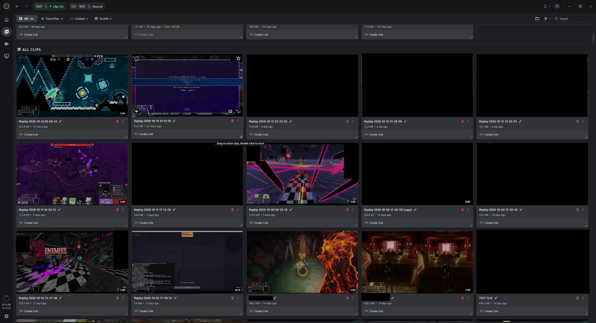
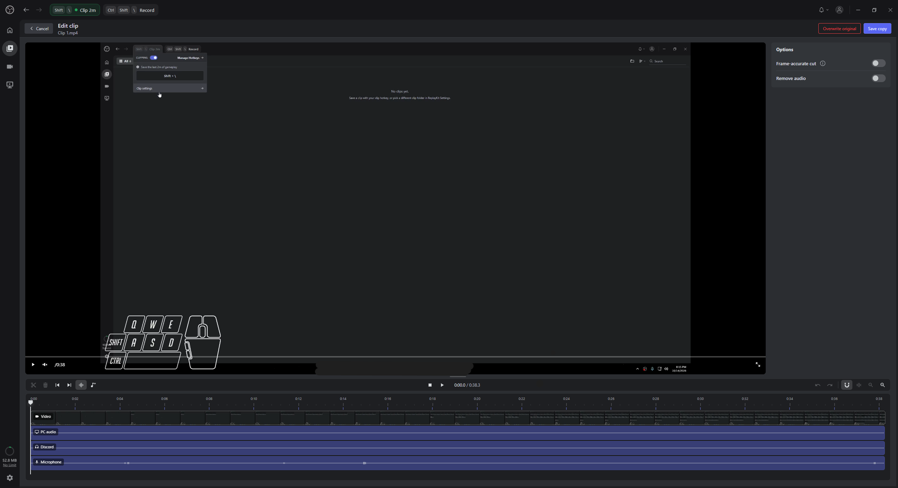
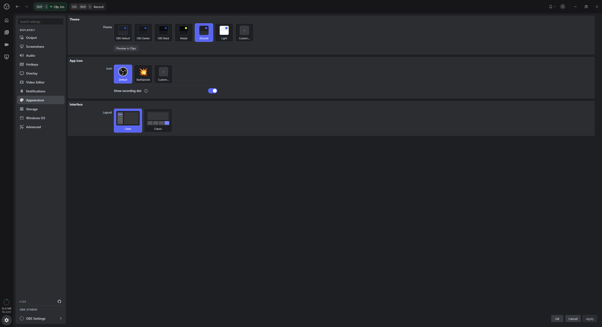

<div align="center">

# OBS ReplayKit

### A Medal inspired clipping experience, right inside OBS Studio.

Save, edit, and share your clips without running another clipping app alongside OBS.

[](#requirements)
[](https://obsproject.com/)
[](#why-replaykit)
[](#why-replaykit)
[](#project-status)

[**Screenshots**](#screenshots) · [**Features**](#features) · [**Getting started**](#getting-started) · [**Build from source**](#building-from-source) · [**Report an issue**](https://github.com/7Lzz/OBS-ReplayKit/issues)

</div>

---

## Why ReplayKit?

OBS already handles recording, streaming, and replays, but finding and sharing clips could be easier. I made ReplayKit because I wanted something similar to Medal that works directly in OBS, with a UI inspired by Medal, so I wouldn't need two recording apps running at once.

The goal is simple: **one app for streaming, recording, clipping, and managing videos.** ReplayKit is free, with no ads, subscriptions, or features locked behind a premium tier. Your clips stay on your PC unless you choose to upload them.

## Screenshots

Click any screenshot to open the full-resolution image.

Screenshots use neutral demo clips and sample audio, with no personal recordings.

### Clip library

Browse saved clips, search your library, and create share links.

[](docs/images/clip-library.png)

### Clip editor

Trim clips using the video filmstrip and separate desktop, Discord, and microphone audio tracks.

[](docs/images/clip-editor.png)

### Appearance and layouts

Choose a theme, customize the app icon, and switch between Clean and Classic layouts.

[](docs/images/appearance.png)

## Features

| | Feature | What it does |
|:--:|---|---|
| 🎬 | **Replay clips** | Save recent gameplay using a hotkey or the Controls dock in OBS. |
| ⏺️ | **Recording** | Start and stop regular OBS recordings from the same dock. |
| 🗂️ | **Clip library** | Find, view, and manage your saved clips. |
| ✂️ | **Editing and compression** | Trim clips and reduce file sizes before sharing. |
| 🔗 | **Streamable uploads** | Upload anonymously or connect your own Streamable account. |
| 🔊 | **Audio options** | Set up desktop, microphone, and Discord audio, including separate tracks. |
| 🎮 | **Overlays and effects** | Optional keyboard and mouse overlays, Bongo Cat, and motion blur. |
| 🖥️ | **Share Preview** | Share your OBS scene in Discord or another compatible app. |
| 🎨 | **Customization** | Change themes and preferences, with desktop notifications for saved clips and recordings. |

ReplayKit uses **OBS's own replay buffer and recording system**. You still have access to your OBS scenes, settings, and recording options.

### Streamable uploads

**A Streamable account is not required.** You can upload clips anonymously or sign in to your account if you want your uploads connected to it.

Signing in also lets you use the retention and upload limits that come with your Streamable plan. If you pay for Streamable Premium, you can use its higher upload limits through ReplayKit. Any upload restrictions or expiration times come from Streamable, not ReplayKit.

## Getting started

### Requirements

- **Windows x64.** macOS and Linux are not supported right now.
- **OBS Studio.** The installer can download and install OBS if you don't already have it.
- **Administrator permission and internet access** for setup and any required downloads.

### Install

1. Go to [Releases](https://github.com/7Lzz/OBS-ReplayKit/releases) and download `OBSReplayKit.exe`.
2. Run the installer and review the installation options. It will set up ReplayKit and back up your OBS settings.
3. Open OBS and finish the ReplayKit setup wizard.
4. In the **Controls** dock, click **Start Clipping** to enable the replay buffer.
5. Use your clipping hotkey or click **Save Clip**, then **View Clips** to find it.

You can also use **Start Recording** and **Stop Recording** in the dock for full recordings.

> [!IMPORTANT]
> **Back up your OBS settings before installing.** ReplayKit changes parts of your OBS setup, including profiles, scenes, and plugins. The installer creates a backup at `%APPDATA%\obs-studio.bak.YYYYMMDD-HHMMSS`, but you should still export anything important. Read the reset and uninstall options carefully if you want to keep your existing OBS setup.

### Audio and Share Preview

You can configure desktop, microphone, and Discord audio separately, including which tracks they use.

**Share Preview is optional.** It uses a virtual audio cable driver and an OBS projector window to let you share your OBS scene in Discord or other apps that support application window sharing. You don't need it for normal recording or clipping.

### Updating or uninstalling

The installer includes options to update, reinstall, or uninstall ReplayKit. Check what each option changes before continuing, especially if you use custom OBS profiles or scenes.

## Building from source

To build the Windows x64 installer, you'll need:

- [Git](https://git-scm.com/) and [GitHub CLI](https://cli.github.com/) (`gh`)
- [.NET 8 SDK](https://dotnet.microsoft.com/download/dotnet/8.0)
- .NET Framework 4.8 developer and targeting pack
- [Visual Studio 2022 Build Tools](https://visualstudio.microsoft.com/visual-cpp-build-tools/) with Desktop development with C++, Windows SDK, CMake, and Ninja
- [OBS Studio](https://obsproject.com/) installed on Windows x64

```powershell
git clone https://github.com/7Lzz/OBS-ReplayKit.git
cd OBS-ReplayKit

gh auth login
.\build.bat
```

The build creates `build/OBSReplayKit.exe` and `build/OBSReplayKit.exe.sha256`. You can compare the checksum with `Get-FileHash`.

> [!NOTE]
> The plugin build scripts expect OBS at `C:\Program Files\obs-studio` and use specific Visual Studio Build Tools paths. You may need to adjust them if your setup is different.

## Project status

ReplayKit is still in development, so features and parts of the UI may change. Check [Releases](https://github.com/7Lzz/OBS-ReplayKit/releases) for available builds.

Bug reports, feature suggestions, and pull requests are welcome in [Issues](https://github.com/7Lzz/OBS-ReplayKit/issues). For bugs, include your OBS and ReplayKit versions, steps to reproduce the problem, and any useful logs. Remove tokens or other private information before sharing logs.

## Credits and license

ReplayKit is my own project, inspired by [Medal](https://medal.tv/) and built around [OBS Studio](https://obsproject.com/). It is not affiliated with Medal or the OBS Project.

There is currently no license file in this repository, so please don't assume the code can be reused or redistributed without permission.
